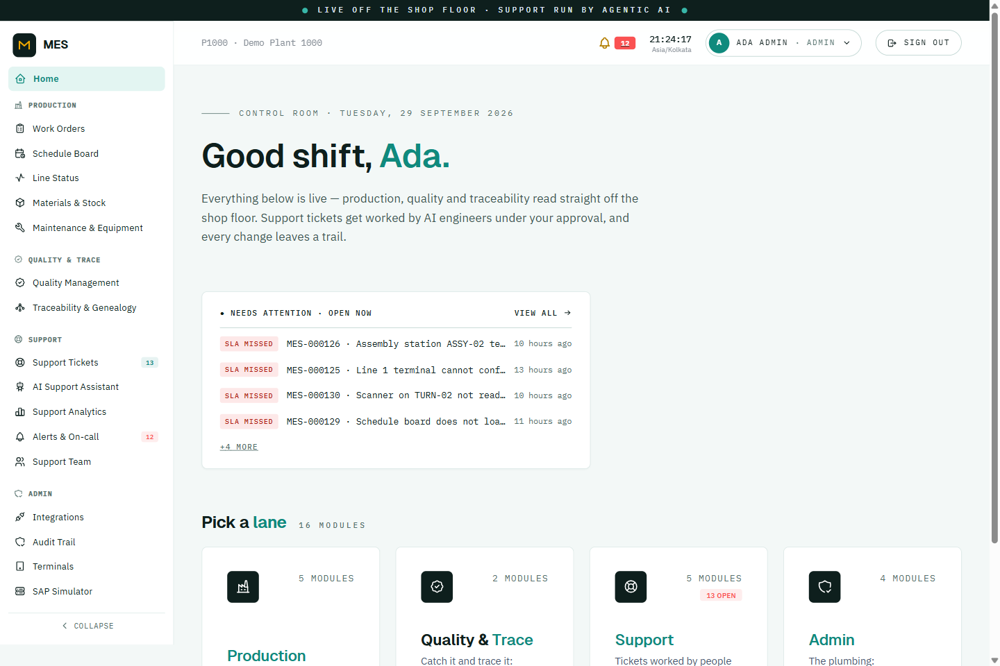
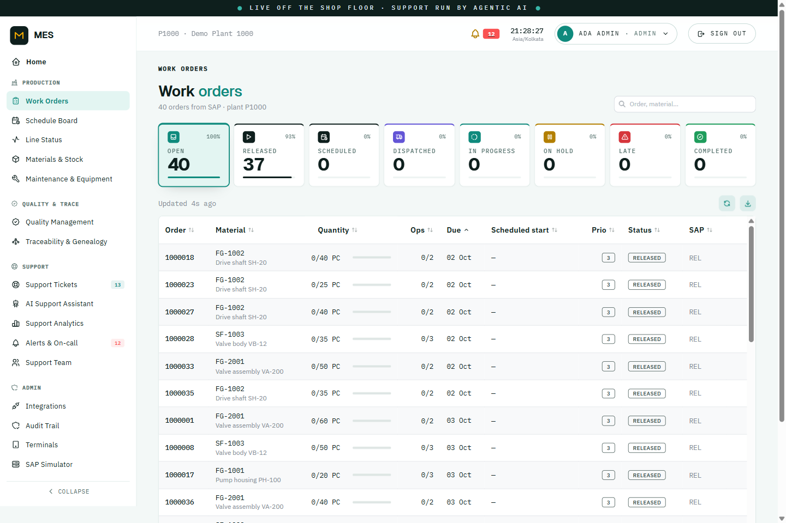
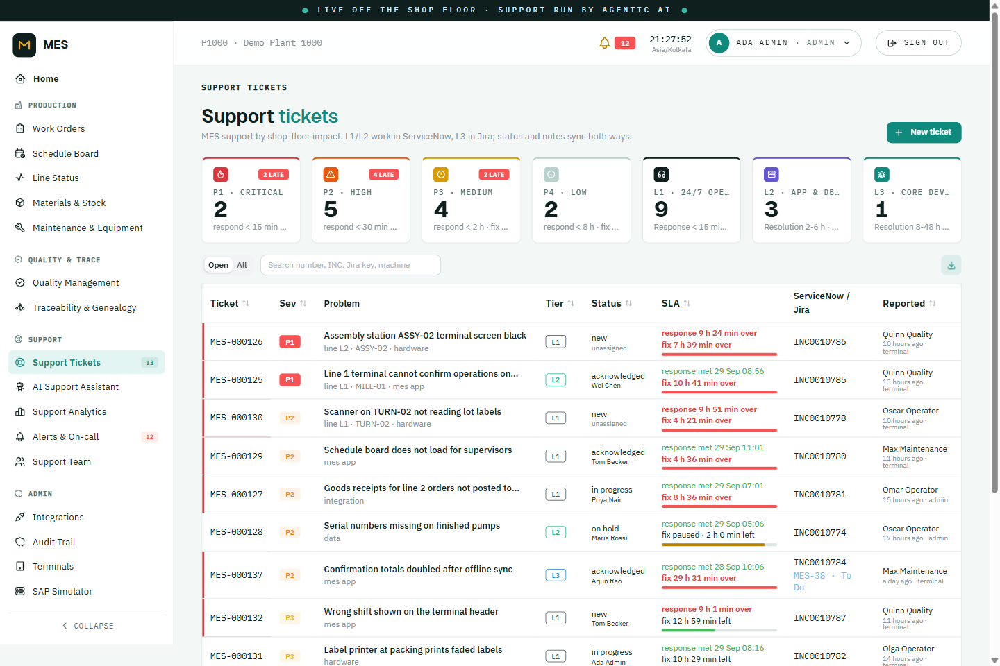
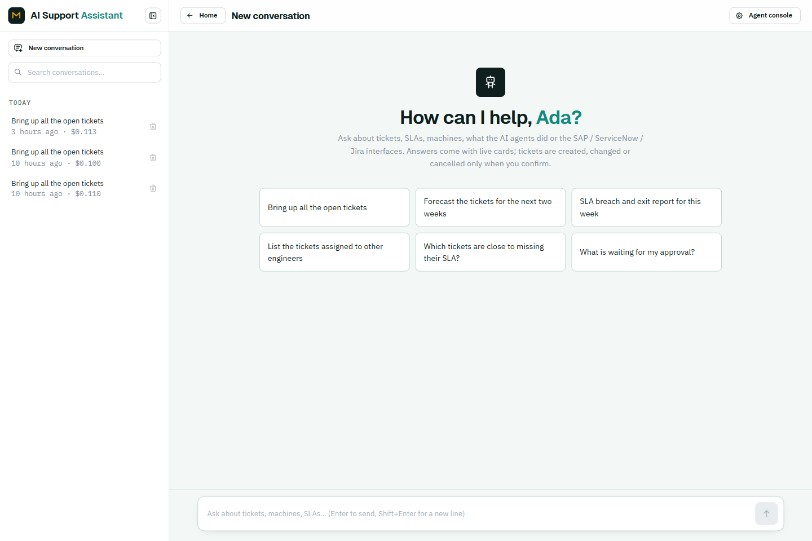

# MES: Manufacturing Execution System (demo scale, production-shaped)

A modular-monolith MES with separate integration services (SAP; real ServiceNow and Jira Cloud over their REST APIs) and an MCP server for AI agents, built in phases.

- **Phase 1**: core data model, OIDC/RBAC, work orders, finite-capacity scheduling, SAP integration (inbound
  production orders, outbound operation confirmations) against a mock S/4HANA, immutable audit trail.
- **Phase 2**: touch-first **operator terminal** (PIN login, setup/run/pause/report/complete, offline queue),
  shop-floor execution with automatic time booking, **material management** (lot-level stock, issue, backflush,
  goods receipt, transfers, shortages; every goods movement posted to SAP), **live line status** (Redis + SSE).
- **Phase 3**: **quality management** (incoming / first-off / final inspection plans, results entered on
  the terminal or in the admin UI, e-signed usage decisions, nonconformances with e-signed dispositions and rework,
  quarantine; stock types free / in quality inspection / blocked, each change posted to SAP), **serial numbers** at
  goods receipt, and **genealogy** (backward/forward trace from a lot, serial or order through machines, operators,
  inspections and component lots).
- **Phase 4**: **equipment & maintenance** (operator-entered breakdowns and downtime, maintenance
  notifications and orders mirrored to SAP PM, spare parts, technician sign-off, preventive plans by calendar or
  running hours, MTBF/MTTR, maintenance windows blocked in scheduling) and **support tickets** following the
  P1-P4 severity matrix and L1/L2/L3 support tiers with SLA clocks, synced both ways with a real **ServiceNow**
  instance (incidents, Table API) and **Jira Cloud** (L3, REST v3); MES itself is an **MCP server** for AI agents.
- **Phase 5**: **AI support engineer** on Claude. It works every new ticket as L1 (triage, diagnosis
  with MES data and runbooks, notes, resolve / escalate / fix actions under a human-approval policy) and talks to
  operators in the terminal's **Get help** chat, raising the ticket for them when it can't be fixed at the line.
- **Phase 6**: **AI L2 engineer**. Tickets escalated to L2 (or raised there automatically, e.g. SAP
  rejected a posting) get a root-cause analysis from service logs (Loki), SAP message history, MES-vs-SAP order data,
  failed events and service health; fixes are proposed for human approval; code defects go to L3 with a Jira-ready
  handover. People can take any ticket over from the AI. All services log structured JSON with request ids.
- **Phase 7**: **alerts and support analytics**. A notifier alerts the on-call rota (e-mail, Teams, in-app
  bell) on P1s, SLA at risk / missed, escalations, AI proposals waiting for approval, AI handovers and a paused agent;
  unacknowledged alerts move to the backup, then the supervisor. A **Support analytics** dashboard (SLA, speed,
  recurring problems, AI contribution and cost, supervisor ratings) and an **evaluation set** that scores the AI
  agents on 12 realistic scenarios.
- **Since Phase 7** (current): a redesigned admin UI (persistent sidebar, live-data connections for the AI agents,
  a knowledge base of runbooks/machine guides/uploads), an **engineer chat** in the AI Support Assistant that answers
  questions with interactive cards and makes changes only through an explicit confirm step, ticket **forecasting**
  and an **SLA breach/exit report**, assignees synced to ServiceNow, and eight weeks of seedable demo ticket history.
  Phase 8 (per-action permission hardening, prompt-injection defence, OAuth, deployment) is scoped but not started.

## Screenshots

| | |
|---|---|
|  |  |
|  |  |

## Quick start

Requirements: Docker Desktop, [uv](https://docs.astral.sh/uv/), Node 20+.

```bash
docker compose up -d --build          # first run takes a few minutes
```

| What | URL | Notes |
|---|---|---|
| Admin / planning UI | http://localhost:3080 | `admin1`, `supervisor1`, `operator1`, `quality1`, `maint1`; password `demo` |
| Operator terminal | http://localhost:3081 | enrol it from the admin UI (**Terminals**); PINs `1111` `2222` `3333` (operators), `4444` (supervisor), `5555` (maintenance technician) |
| Core API (OpenAPI) | http://localhost:8000/docs | bearer token from Keycloak |
| ERP adapter API | http://localhost:8020/docs | integration monitor backend |
| ITSM adapter API | http://localhost:8070/docs | ticket sync monitor backend (ServiceNow / Jira connections) |
| Support agent API | http://localhost:8090/docs | AI support agent: runs, approvals, policy, terminal chat |
| Grafana (logs) | http://localhost:3090 | Explore → Loki: `{service="core-api", level="ERROR"}`; admin `admin` / `admin` |
| Loki | http://localhost:3100 | log store (the AI L2 agent searches it) |
| Mailpit | http://localhost:8025 | catches the alert e-mails of the demo (real SMTP via `.env`) |
| Notifier API | http://localhost:8095/docs | alerts, on-call rota, alert rules |
| MES MCP server | http://localhost:8040/mcp | for AI agents; `Authorization: Bearer mes-mcp-demo-key` (Claude Code: `.mcp.json`) |
| Mock SAP | http://localhost:8030/docs | OData under `/sap/opu/odata/sap/…`, demo controls under `/_mock/…` |
| Keycloak | http://localhost:8080 | admin console: `admin` / `admin` |
| Redpanda Console | http://localhost:8081 | watch events flow between services |
| PostgreSQL | localhost:**5433** | 5433 so it does not clash with a local PostgreSQL |

On first start mock SAP seeds 40 production orders; they appear in MES within one poll cycle (~10 s).

### Connecting ServiceNow and Jira Cloud

Support tickets sync with your own ServiceNow instance and Jira Cloud site; there are no mock ITSM systems in the
stack. Until they are configured, tickets work in MES and their sync messages wait (*Integrations* shows "not
configured"); they go out once connected.

1. **ServiceNow**: a free Personal Developer Instance (developer.servicenow.com) works. Create an integration user
   (e.g. `mes.integration`, role `itil`, "Web service access only" is fine). Changes made by this user are treated
   as coming from MES and are not echoed back, so work the incidents as a different user.
2. **Jira Cloud**: a free site works. Create a project (key `MES`, or set `JIRA_PROJECT`) with issue types Bug and
   Task, and an API token for the account at id.atlassian.com → Security → API tokens. Leave Jira empty to keep L3
   in ServiceNow only.
3. `cp .env.example .env` and fill it in. `.env` is git-ignored; keep credentials out of the repo and out of chats.
4. `docker compose up -d itsm-adapter-api itsm-adapter-worker`, then check (creates the three tier groups if
   missing; needs a user allowed to create groups, e.g. `admin` on a PDI, otherwise create them by hand):
   `docker compose exec itsm-adapter-api python -m itsm_adapter.setup --create-groups` → `READY`.

How it maps (the usual MES ↔ ITSM pattern): each MES ticket is one ServiceNow **incident** (`correlation_id =
MES:<ticket id>`, `correlation_display = MES`, `contact_type = integration`), severity P1–P4 → impact/urgency
(→ priority), tier L1/L2/L3 → assignment group, MES status → incident state (On Hold with a hold reason, Resolved
with resolution code + notes), MES comments → work notes. At **L3** a Jira **Bug** (or Task for change/access
requests) is created with label `mes-ticket-<id>` and linked by a work note. Every 15 s the adapter reads back
incidents and issues changed by anyone else (state, group, priority, work notes / comments, Jira status and comments)
and applies them to the MES ticket; a Jira issue moving to Done adds a work note for L2 to verify. `ITSM_MODE=mcp`
switches the same operations to MCP servers (`SERVICENOW_MCP_*`, `JIRA_MCP_*`).

### Switching the AI support agent on

Put `ANTHROPIC_API_KEY=...` (console.anthropic.com → API keys) in `.env` and run
`docker compose up -d support-agent-api support-agent-worker`. Without a key the agent stays idle and tickets go to
people as before. Note: Docker Compose prefers variables already set in your shell/Windows environment over `.env`; if
`ANTHROPIC_API_KEY` is set there (e.g. an old key), remove it or start with `env -u ANTHROPIC_API_KEY docker compose ...`. Optional: create a ServiceNow assignment group **MES AI Support** and set
`GROUP_L1=MES AI Support`, so L1 incidents show the AI as their assignee and escalations go to your L2 engineers.

The agent runs as its own Keycloak service account (`mes-support-agent`, role `ai_support_agent`); everything it
does goes through the MES APIs, so MES permissions and the audit trail apply. Every write action has a policy
(**AI support → Policy**, admins): *off*, *suggest* (a supervisor approves; it then runs with the approver's own
login) or *auto*. Defaults: notes and escalations auto, everything else suggest. There is a kill switch and a cost
limit per ticket and per chat.

### Demo script (about 5 minutes)

1. **Work orders**: 40 orders imported from SAP (ERP status `REL` → MES `RELEASED`, `CRTD` → `IMPORTED`).
2. **Schedule board** → *Create schedule* → *Auto-sequence* → drag operations between machines (snaps to shift time;
   overlaps are rejected by the database) → *Publish…*: e-signature with meaning, reason and signer.
3. Open an order → *Dispatch to floor* → *Confirm…* an operation. The confirmation shows "sending to SAP", then
   the SAP confirmation number.
4. **SAP simulator** → Fault injection → *Commit, then time out* = 1 → confirm another operation. On **SAP integration**,
   attempt 1 is `AMBIGUOUS` (timeout) and attempt 2 is `RECONCILED`: the adapter found the posting SAP had already
   committed and did **not** post it again. The simulator's confirmation list shows exactly one posting.
5. **Audit trail**: every change above with before/after values, actor, reason and e-signature. *Verify hash chain* (admin).
6. In the simulator, set an order to *TECO* → it becomes `CLOSED` in MES.

**Phase 2, shop floor** (about 5 more minutes):

1. Admin UI → **Terminals** → *Enrol device* on `T-L1` → *Open terminal here*. PIN `1111`.
2. The terminal shows line L1's machines and its work queue (dispatched orders in planned order). Tap an operation
   → **Issue** the raw material (lot picked FIFO from line-side) → **Start setup** → **Start production**.
3. **Report qty** on the keypad: setup and run minutes are booked from the timestamps, the confirmation goes to SAP.
   On an assembly order (line L2, PIN `2222`), seals are **backflushed** automatically.
4. Terminal menu (⋯) → *Simulate network outage* → **Pause** (reason *Material shortage*). The action is saved on the
   terminal ("1 to sync"). Switch the outage off: it syncs, and the supervisor's **Line status** shows the machine
   paused, live.
5. **Complete** the last operation: the good quantity is received into finished goods as a new lot (101).
   **Materials** shows stock by lot, the movements with their SAP material documents, and **Shortages** with a
   one-click *Replenish* (311 transfer to line-side).

**Phase 3, quality and traceability** (about 5 more minutes):

1. On the terminal (`T-L1`, PIN `1111`) open operation **0020** of a pump housing order (`FG-1001`) → *Start
   production*: a **first-off inspection** opens and *Report qty* stays locked. *Enter results* → flange diameter
   `119.8` (tolerance 119.95–120.05) → the inspection **fails**, a nonconformance is opened and the order goes on
   **quality hold** (red banner; *Resume* is refused). Pause with reason *Quality check*.
2. Admin UI as `supervisor1` → the order → *Resume* (reason). On the terminal, *Resume* opens a **repeat check** →
   `120.02` → passed → report and complete; finish operation 0030. The goods receipt goes into **quality inspection
   stock** with **serial numbers** (shown on the terminal).
3. As `quality1` → **Quality** → *Awaiting usage decision* → the final inspection lot → enter results → *Accept →
   free stock* → **e-signature**. SAP gets a 321 transfer posting (stock type 02 → free). The failed first-off's
   nonconformance is under *Nonconformances*: choose a disposition and sign.
4. **Materials** → *Receive material* `CP-SEAL-12`: it lands in QI stock with an incoming inspection and can't be
   issued until released.
5. **Traceability** → search the order, a lot (`L…`) or a serial (`FG-1001-…`) → backward tree (machines, operators,
   inspections, raw material lots) and forward tree; from a suspect raw lot, *Quarantine affected lots…* blocks
   every downstream lot with free stock (344/350) under one nonconformance each.

**Phase 4, maintenance and support** (about 5 more minutes):

1. Terminal `T-L1`, PIN `1111` → **Get help** → *Machine problem* → `TURN-01`, *Yes, it is down*, *Electrical
   failure* → *Call maintenance*. The machine strip shows it DOWN (a run on it is paused and can't resume); a
   breakdown notification is mirrored to SAP PM. (Pausing a run with *Machine issue* leads to the same dialog.)
2. **Get help** → *MES / system problem* → *Scanner or label printer* → *The line is stopped* (**P1**) → *Send to
   support*. Within seconds it is an incident `INC…` in group *MES L1 Operations* in your ServiceNow instance.
3. Log out, PIN `5555` (technician): **Maintenance** tab → *Take it* → *Start work* → tick the checklist, book a spare
   part (261 to the PM order in SAP) → findings → *Sign off and release machine* (e-signature). The machine is
   available again; SAP gets TECO.
4. Admin UI as `supervisor1` → **Support tickets**: severity and tier cards with SLA countdowns. Open the P1 →
   *Acknowledge* → *Escalate to L2* → *Escalate to L3 (Jira)*: a Jira issue appears in your project and a work note
   links it in ServiceNow (the ticket drawer links to both). In ServiceNow, work the incident as an engineer (state,
   work note) or move the Jira issue to Done: it shows up in the MES ticket's activity.
5. **Maintenance**: machine health (MTBF/MTTR), notifications, orders, downtime log, preventive plans (the washer's
   weekly filter change is due: *Run scheduler now*). The **Schedule board** hatches maintenance windows.
6. **Integrations** → *ServiceNow / Jira*: both connections (reachable, as which user, project issue types) and every
   ticket sync with the exact REST calls it made (method, path, HTTP status, duration).
7. AI agents: with the stack running, Claude Code in this repo sees the `mes` MCP server (`.mcp.json`). Ask it e.g.
   "which tickets are close to breaching their SLA?" or "trace serial FG-1001-0000001".

**Phase 5, AI support engineer** (needs `ANTHROPIC_API_KEY`):

1. Terminal `T-L1`, PIN `1111` → **Get help** → *Talk to the support assistant* → "the label printer prints blank
   labels". The assistant checks the terminal and machine (status line), asks one question at a time with big answer
   buttons, and walks the operator through the runbook. "It works now" → recorded as a resolved ticket; "still
   blank" → it raises the ticket with what it checked, and shows the number.
2. Admin UI → **Support tickets** → that ticket → the **AI support agent** panel: its diagnosis note, the run
   (every tool call, what Claude said, tokens and cost) and any proposal (e.g. *resolve*) with Approve / Reject.
3. Raise a ticket from the admin UI, e.g. "confirmation for order 1000123 not in SAP": within seconds the agent
   looks at the SAP queue (`get_integration_errors`), writes its finding as a ServiceNow work note and proposes a
   retry or escalates to L2 with a handover summary.
4. **AI support** page: activity (runs, outcomes, cost), **Approvals**, **Operator chats** (full transcripts),
   **Policy** (switch *resolve* to *auto*, or pull the kill switch and watch the terminal fall back to the form).

**Phase 6, AI L2 engineer**:

1. Make SAP reject a posting: SAP simulator → *Fault injection* → fail next 1 with 503; confirm an operation of a
   dispatched order; right after, *TECO* that order in the simulator. The retry is rejected ("technically
   completed") and MES raises an automatic L2 ticket.
2. Within a minute the ticket's **AI support agent** panel shows **AI L2 · root cause found**: the root-cause card
   (category, confidence, evidence: the SAP attempts, the MES vs SAP order status, the timeline) and the fix. Here it
   is a business decision for the SAP planner (reopen the order, then retry), so the agent leaves a precise note
   and does not retry or escalate to L3. A MES code defect would instead go to L3 with steps to reproduce,
   expected/actual, request ids and log lines, and appear on the Jira issue.
3. *Take over* on the panel stops the AI on that ticket; *Hand back to AI* re-runs it.
4. Grafana (:3090) → Explore → Loki: `{service="erp-adapter-worker"} |= "1000…"` shows what the agent read; a
   request id from an error line followed across services with `|= "<request id>"`.

**Phase 7, alerts and analytics**:

1. Raise a P1 (terminal *Get help*, "The line is stopped"). Within seconds the L1 on call and the supervisor get an
   e-mail (Mailpit, :8025) and the bell in the admin header counts it. Don't acknowledge it: after the rule's time
   (P1: 10 min) the backup gets it, then the supervisor. *Acknowledge* on **Notifications** (or the link in the mail)
   stops that. The alert closes itself when the ticket is acknowledged or resolved.
2. **Notifications → On-call rota / Alert rules**: who is on call per tier, which alerts go where, and after how many
   minutes they escalate. *Send a test alert* checks the channels. Teams: set `TEAMS_WEBHOOK_URL` in `.env`.
3. **Support analytics**: tickets per day, SLA met per severity, time to respond / resolve, categories, recurring
   machines, and the AI section (tickets worked, resolved by AI incl. approved proposals, proposals approved, approval
   wait, fixed-in-chat, cost per ticket and per day, supervisors' 👍/👎 on runs).
4. **AI support → Evaluation**: `docker compose exec support-agent-worker python -m support_agent.evals` runs the 12
   scenarios against Claude (about $0.15-0.30 each) and shows pass/fail per check.

The same walkthroughs run headless: `uv run python scripts/smoke_test.py` (prints PASS/FAIL).

## Architecture

```
 Terminal (kiosk) ─────────nginx /api/core──┐   Redis (live state, pub/sub → SSE)
 Browser (React admin UI) ──nginx /api/core──> mes-core API ──┐
                          ──/api/erp────────> erp-adapter API │    PostgreSQL / TimescaleDB
                          ──/api/itsm───────> itsm-adapter API│
                                                              ├──  mes_core        (system of record + audit)
 mes-core worker  ── outbox relay / inbox consumer / sealer ──┤    mes_integration (adapter state)
        ▲  mes.confirmations.v1        erp.work-orders.v1  │   └──  keycloak
        │  mes.planning.v1   Redpanda  erp.confirmation-results.v1
        ▼                                                  ▼
 erp-adapter worker ── poll OData / post confirmations + material documents + PM ──> mock SAP (S/4HANA OData V2)
 itsm-adapter worker ── mes.tickets.v1 -> REST ──> ServiceNow Table API, Jira Cloud REST v3 ── poll back
 AI agent (Claude, ...) ── MCP ──> mes-mcp ── REST as service account mes-mcp ──> mes-core API
 support-agent (api + worker) ── Claude (Anthropic API) + tools ── REST as mes-support-agent ──> core, ERP, ITSM APIs
     ▲ mes.tickets.v1 (new, escalated)      ▲ terminal chat (SSE via /api/agent)      └─ logs: Loki (via Alloy)
 all containers ── stdout (JSON lines, request ids) ──> Alloy ──> Loki ──> Grafana, AI L2 agent
 notifier (api + worker) <── mes.tickets.v1, ai.support.v1 ── alerts ──> e-mail (SMTP/Mailpit), Teams, admin bell
```

- **mes-core** (`services/core`): modular monolith. Modules: `org`, `identity`, `masterdata`, `planning`,
  `execution`, `inventory`, `quality`, `genealogy`, `maintenance`, `ticketing`, `compliance`, `erp_sync`. Live machine state is pushed to **Redis** after each change and
  relayed to browsers over server-sent events (any number of API replicas). Each module exposes only `public.py` to the others; this is enforced by
  import-linter (`cd services/core && uv run lint-imports`). One Postgres schema per module.
- **erp-adapter** (`services/erp-adapter`): owns everything SAP-specific. Core never sees SAP field names; the
  contract is the canonical events in [`contracts/events`](contracts/events).
- **operator terminal** (`frontend/apps/terminal`): kiosk app. Device enrolment token + operator PIN → MES-issued
  session token with operator rights only. Every action carries a client event id; offline actions are queued in
  local storage and replayed in order (the server ignores duplicates).
- **itsm-adapter** (`services/itsm-adapter`): owns everything ServiceNow/Jira-specific behind two ports
  (`ports.py`); connectors for the ServiceNow Table API and Jira Cloud REST v3 (default) or MCP tools
  (`ITSM_MODE=mcp`). Applies each MES ticket change idempotently (lookup by correlation id / label, markers on
  notes, only the changed fields), retries 429/5xx/timeouts, fails fast on 401/403/4xx, and polls engineers'
  changes back.
- **mes-mcp** (`services/mes-mcp`): MES as an MCP *server* for AI agents (tickets, SLA, line status, equipment
  health, maintenance orders, orders, nonconformances, genealogy). Stateless; every tool calls the core API as the
  Keycloak service account `mes-mcp` (role `ai_agent`), so permissions, plant scope and audit apply.
- **support-agent** (`services/support-agent`): the AI support engineer. Worker: new tickets from
  `mes.tickets.v1` → queued runs → an agent loop on Claude (streaming, prompt caching, refusal fallback) with read
  tools (tickets, runbooks in `knowledge/runbooks`, machines, lines, orders, terminals, SAP/ServiceNow queues,
  audit trail, quality, shortages) and policy-gated write tools. API: the terminal chat (server-sent events), runs
  with every step, proposals, policy, status. Own tables in `mes_integration` (schema `agent`). Ticket and chat text
  is treated as data (tagged, never instructions); tools act only on the current ticket or conversation; step and
  cost limits hand the ticket to a human; a rejected API key pauses the agent instead of touching tickets.
- **notifier** (`services/notifier`): alert rules over ticket and AI-agent events, the on-call rota per tier with
  escalation (primary -> backup -> supervisor when not acknowledged in time), e-mail (SMTP), Teams (incoming webhook)
  and the in-app list; alerts close themselves when the cause goes away. Own tables (schema `notify`).
- **mock-itsm** (`services/mock-itsm`): headless ServiceNow and Jira MCP servers, used only by the adapter's tests
  (the REST connectors are tested against in-memory fakes of both APIs).
- **mock-sap** (`services/mock-sap`): speaks S/4HANA OData V2 (`API_PRODUCTION_ORDER_2_SRV`, `API_PRODUCT_SRV`,
  `API_PROD_ORDER_CONFIRMATION_2_SRV`, `API_MATERIAL_DOCUMENT_SRV`, `API_MAINTNOTIFICATION`, `API_MAINTENANCEORDER`) with basic auth, CSRF-token handshake and SAP-style
  errors. It can inject faults.
- **libs/mes-common**: event envelope, transactional outbox + idempotent inbox, Kafka helpers, JWT verification.

### Guarantees and how they are implemented

| Guarantee | Mechanism |
|---|---|
| Every business write is audited | `AFTER` row trigger on every business table writes before/after JSON, actor, request id, reason and signature to `audit.audit_log`. A write with no actor context is **rejected by the database**. |
| The audit log is immutable | Runtime role `mes_app` can only `SELECT` it; a guard trigger blocks `UPDATE`/`DELETE`. A sealer chains rows with SHA-256 (`audit.verify_chain()`). |
| No lost or duplicated events | Transactional outbox (event row commits with the business change) + inbox table keyed by `event_id`. Kafka offsets are committed after the DB commit. |
| No duplicate SAP postings | The MES confirmation id is the idempotency key, written into SAP `ConfirmationText`. Every retry first *looks the posting up* in SAP and only re-posts if SAP has no record of it. Messages for one order are sent in order. |
| Out-of-order ERP updates are ignored | Upserts compare SAP `LastChangeDateTime`; older snapshots are discarded. |
| No double-booked machines | `EXCLUDE USING gist (schedule_id =, equipment_id =, tstzrange &&)` on `planning.schedule_entry`. |
| Concurrent edits don't clobber | `row_version` on every table (SQLAlchemy optimistic locking), exposed to clients. |
| Multi-plant ready | `plant_id` on every business table; user → plant scopes in `identity.user_scope`; roles from Keycloak. |
| One job per machine | Partial unique indexes: one active run per machine and per operation. |
| Offline terminal can't double-post | `client_event_id` unique on events, confirmations and goods movements; runs can have client-generated ids. |
| Stock never goes negative | Lot-level `stock` rows updated in the movement's transaction, `CHECK (quantity >= 0)`; FIFO backflush fails loudly on a shortage. |
| No duplicate ServiceNow incidents / Jira issues | MES ticket id as `correlation_id` / Jira label, looked up before every create; notes carry `[MES:<activity id>]`. Changes made by the integration user are not echoed back. |
| A machine under repair isn't scheduled or run | Maintenance windows and down machines are subtracted from the machine's calendar; runs can't start or resume unless the machine is AVAILABLE. |
| Secrets stay out of the audit log | Audit trigger redacts named columns (PIN hash/lookup, device token hash) but still records that they changed. |

## Development

```bash
uv sync --all-packages                        # Python deps for all services
docker compose up -d postgres redpanda keycloak mock-sap
cd services/core && uv run alembic upgrade head && uv run python -m mes_core.seed
uv run uvicorn mes_core.main:create_app --factory --reload            # core API :8000
uv run python -m mes_core.worker                                      # core worker

cd frontend && npm install && npm run dev:admin                       # UI on :5173 (proxies to local services)
npm run dev:terminal                                                  # terminal on :5174
```

Tests:

```bash
cd services/core && uv run pytest            # 58 tests, testcontainers Postgres + Redis (needs Docker)
cd services/erp-adapter && uv run pytest     # 12 tests against a live mock SAP over HTTP
cd services/itsm-adapter && uv run pytest    # 13 tests: REST connectors (API fakes) and MCP mode (headless mocks)
cd services/mes-mcp && uv run pytest         # MES MCP server
cd services/support-agent && uv run pytest   # 31 tests: scripted model + fake MES API, engineer chat, MCP client, knowledge store (no Claude calls, no cost)
cd services/data-mcp && uv run pytest        # 13 tests: read-only MES/SAP MCP servers
cd services/notifier && uv run pytest        # 6 tests: alerts, escalation, auto-close, API, real SMTP delivery
cd frontend/apps/admin && npx playwright test   # admin + terminal UI tests against the running stack
uv run python scripts/smoke_test.py          # end-to-end incl. timeout reconciliation (ITSM part if connected)
```

Other commands:
- Regenerate the UI's typed API client after changing core endpoints:
  `uv run python services/core/scripts/export_openapi.py`, then `npm run gen:api` in `frontend/`
- Regenerate event contracts: `uv run python scripts/export_contracts.py`
- New migration: `cd services/core && uv run alembic revision --autogenerate -m "..."`. Then add
  `attach_audit_trigger()` for every new business table (`tests/test_audit.py` fails otherwise).

## Status

See [CLAUDE.md](CLAUDE.md) → *Current State* for what is built, what is mocked, and what comes next.
